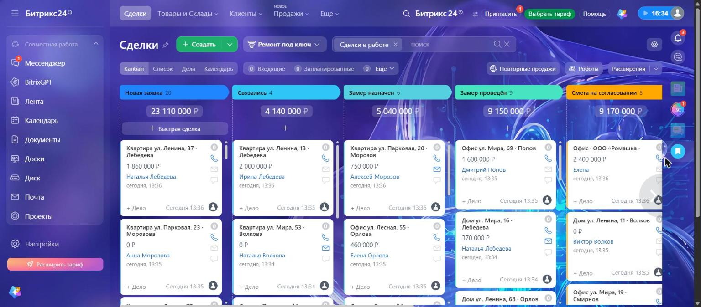
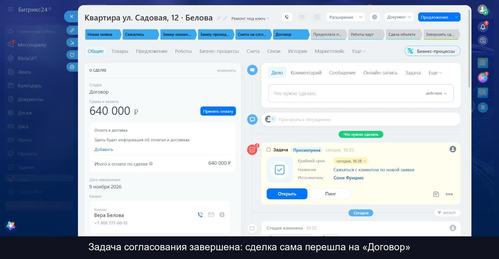
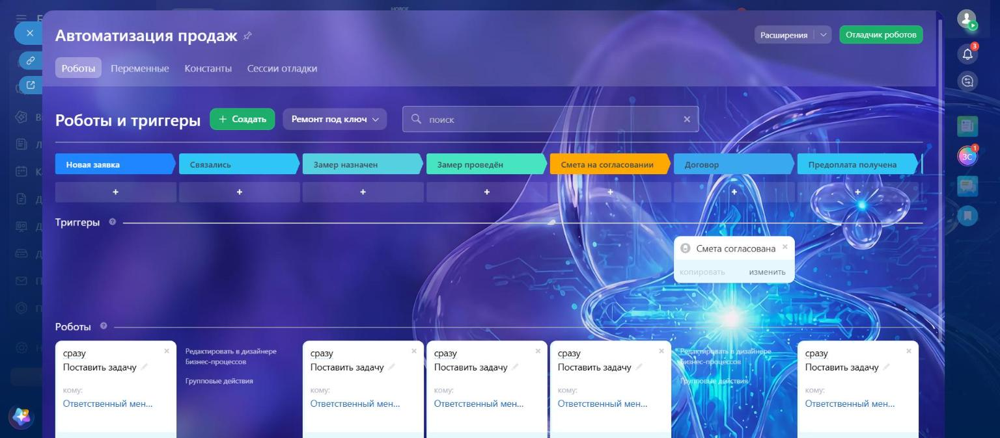

# Битрикс24 для ремонтной компании

Настройка CRM под цикл «заявка, замер, смета, договор, предоплата, работы, сдача» и перенос клиентской базы из Excel.

Видео, 20 секунд: [img/flow.mp4](img/flow.mp4)

| Воронка | Карточка сделки | Роботы и триггер |
|---|---|---|
|  |  |  |

## Как было и как стало

| | Как было | Как стало |
|---|---|---|
| Клиенты | Таблица Excel: телефоны в разных форматах, повторы, тестовые строки | Контакты и сделки в CRM, по одному контакту на телефон |
| Стадии | Статус свободным текстом: «звонили», «был замер», «дорого» | Воронка из 11 стадий |
| Контроль | Менеджер держит задачи в голове | Роботы ставят задачу со сроком при входе на стадию |
| Смета | Договорённости теряются в переписке | Завершение задачи «Согласовать смету» переводит сделку на «Договор» |

Подробнее: [ТЗ](docs/tz.md), [инструкция для менеджера](docs/manager.md).

## Воронка «Ремонт под ключ»

Новая заявка → Связались → Замер назначен → Замер проведён → Смета на согласовании → Договор → Предоплата получена → Работы идут → Сдача объекта → Объект сдан / Отказ.

Поля сделки: тип объекта, вид ремонта, площадь, адрес объекта, дата замера, причина отказа. Создаются скриптом `setup_crm.py`, повторный запуск ничего не дублирует.

## Автоматизация

| Стадия | Что происходит | Срок |
|---|---|---|
| Новая заявка | Задача «Связаться с клиентом по новой заявке» | 15 минут |
| Замер назначен | Задача «Подтвердить замер с клиентом» | 4 часа |
| Замер проведён | Задача «Подготовить смету по итогам замера» | 2 дня |
| Смета на согласовании | Задача «Согласовать смету с клиентом» | 3 дня |
| Договор | Триггер: задача согласования завершена, сделка переходит на стадию | |
| Предоплата получена | Задача «Назначить бригаду и дату начала работ» | 1 день |
| Сдача объекта | Задача «Подписать акт сдачи и получить оплату» | 3 дня |

Триггер срабатывает только на задачу со словами «Согласовать смету» в названии. Без этого условия завершение любой задачи по сделке переводило бы её на «Договор».

## Перенос из Excel

```
python make_clients_xlsx.py                          # таблица clients_old.xlsx
python import_clients.py clients_old.xlsx            # проверка, в CRM ничего не пишется
python import_clients.py clients_old.xlsx --apply    # перенос
```

Что делает скрипт:
- приводит телефоны к виду `+7XXXXXXXXXX`, почту к нижнему регистру, суммы вроде «2,4 млн» и «350 т.р.» к числу;
- сливает повторы по телефону или почте, пустые поля дополняет из повтора;
- сопоставляет статусы свободным текстом со стадиями воронки;
- отклоняет строки с причиной и пишет их в `import_rejected.csv`, чтобы их можно было исправить;
- при повторном запуске не создаёт дублей.

Результат прогона:

| Показатель | Значение |
|---|---|
| Строк с данными | 98 |
| Перенесено клиентов | 85 |
| Слито повторов | 9 |
| Отклонено | 4 (тестовая запись 1, неверный телефон 2, нет контактов 1) |
| Второй запуск | создано 0 контактов и 0 сделок |

## Что пришлось решить

| Проблема | Причина | Решение |
|---|---|---|
| `crm.status.add`: нельзя создать промежуточную стадию после успешной | Стадии добавлялись по порядку, а успешная уже стояла раньше них | Сначала задаём положение финальных стадий, затем добавляем остальные |
| Списки в сделке не заполнялись текстом | Значения списков в Битрикс24 задаются по id | Читаем id через `crm.deal.userfield.get` и подставляем их |
| Битрикс предложил объединить 44 контакта-«дубликата» | Сравнение по имени, а это разные люди с разными телефонами | Автообъединение не включали, по телефону и почте дублей нет |
| «ООО Ромашка (Елена)» превратилось в «Ооо Ромашка (елена)» | Название компании разбиралось как ФИО | Компании не разбираем и не меняем регистр, добавлен тест |

## Как проверялось

- Автотесты разбора данных: `python -m pytest test_import_clients.py`.
- Робот: новая сделка получает задачу со сроком.
- Согласование: посторонняя задача стадию не меняет, задача согласования переводит сделку на «Договор».

## Файлы

- `b24.py`: клиент REST API с повторами при сбоях и соблюдением лимита запросов.
- `setup_crm.py`: воронка, стадии, поля.
- `make_clients_xlsx.py`, `import_clients.py`, `test_import_clients.py`: перенос и тесты.

Адрес вебхука берётся из переменной `B24_WEBHOOK` или файла `.env`, в репозиторий он не попадает. Роботы и триггер настраиваются в интерфейсе портала, в REST API для вебхука таких методов нет.
