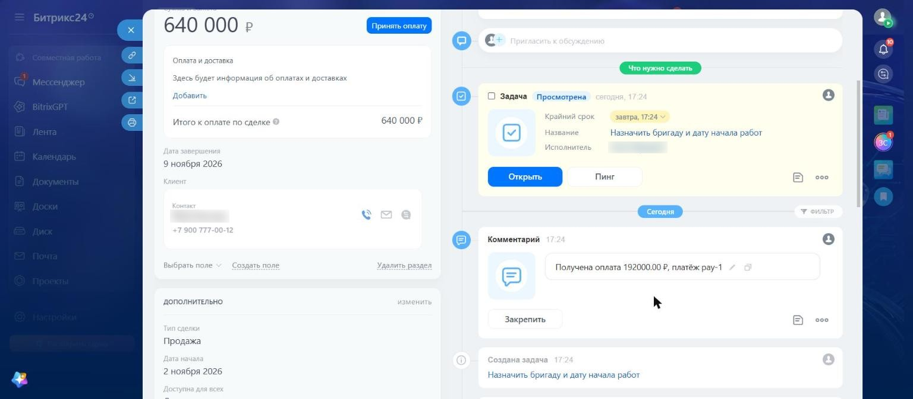

# Оплата сделки: ЮKassa и Битрикс24

Менеджер получает ссылку на предоплату из сделки, а после оплаты сделка сама переходит на стадию «Предоплата получена» и робот ставит задачу назначить бригаду.



## Как работает

```
Сделка на «Договоре» → POST /deals/<id>/pay → платёж в ЮKassa → ссылка в ленте сделки
Клиент оплатил → уведомление ЮKassa → проверка платежа через API → журнал → стадия и комментарий в CRM
```

## За счёт чего это надёжно

| Что может случиться | Что происходит |
|---|---|
| Поддельное уведомление об оплате | Статус и сумма перечитываются из API ЮKassa, стадия не меняется |
| Уведомление пришло дважды | Запись одна на платёж, второй раз ничего не меняется |
| Менеджер дважды нажал «создать ссылку» | Ключ идемпотентности один, платёж остаётся один |
| Сумма не совпала с ожидаемой | Сделка не двигается, событие пишется в журнал |
| ЮKassa недоступна при проверке | Ответ 503, ЮKassa пришлёт уведомление ещё раз |
| CRM недоступна | Оплата остаётся в журнале и уходит в CRM при повторе раз в 5 минут |
| Сделка уже ушла дальше | Стадия не откатывается назад, добавляется только комментарий |
| Чужой запрос на создание ссылки | Нужен токен, сравнение через `hmac.compare_digest` |

## Обмен с учётной системой

- `export_for_1c()`: CSV с оплатами (дата, сумма, номер платежа, сделка, назначение) для загрузки в 1С.
- `reconcile()`: сверка оплат ЮKassa с журналом. Показывает, чего нет в журнале, чего нет в кассе, где не сошлась сумма и что не дошло до CRM.

## Как проверялось

- 16 автотестов на сценарии из таблицы и HTTP-сервер: `python -m pytest`.
- Прогон на портале Битрикс24 с ЮKassa: ссылка из сделки, повторный запрос ссылки, оплата, уведомление от ЮKassa, смена стадии, задача робота. Затем повтор уведомления, поддельное уведомление по неоплаченному платежу, выгрузка и сверка с API ЮKassa.
- Сбои проверены вживую с платежом в ЮKassa и порталом. Обрыв связи с ЮKassa: ответ 503, платёж не отмечается оплаченным. Обрыв связи с CRM: оплата остаётся в журнале, сверка показывает её как не дошедшую, а после восстановления повтор переводит сделку на нужную стадию. Сделка, ушедшая дальше, не откатывается.
- Падение сервиса: оплата прошла, пока сервис был остановлен, ЮKassa получала ошибку 502. После запуска сервиса она сама прислала уведомление повторно, и сделка перешла на нужную стадию. После отказа по карте та же ссылка осталась рабочей.

## Файлы

- `service.py`: логика оплат, журнал SQLite, выгрузка, сверка.
- `yookassa.py`: клиент API ЮKassa.
- `server.py`: HTTP-сервер для уведомлений и создания ссылок.
- `test_payments.py`, `test_server.py`: тесты.
