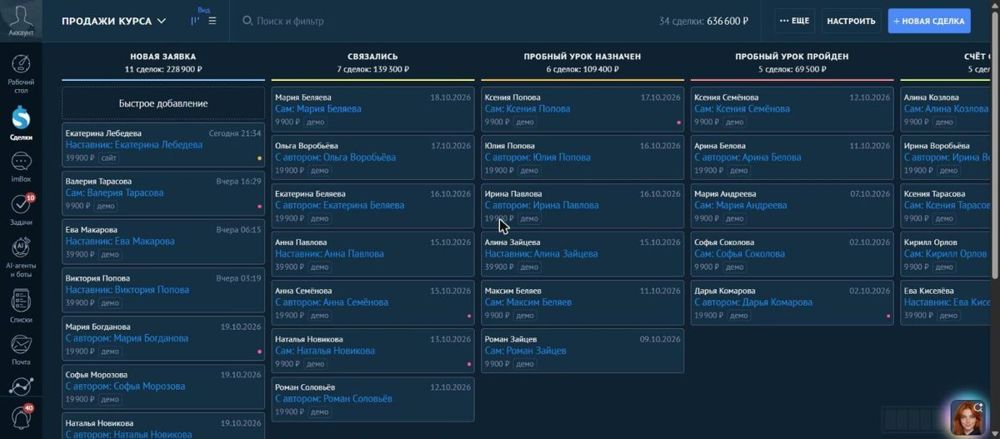
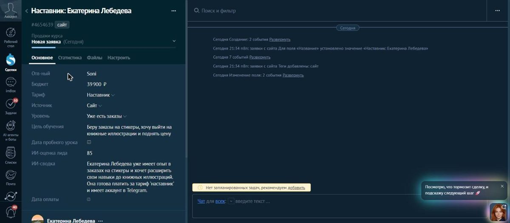
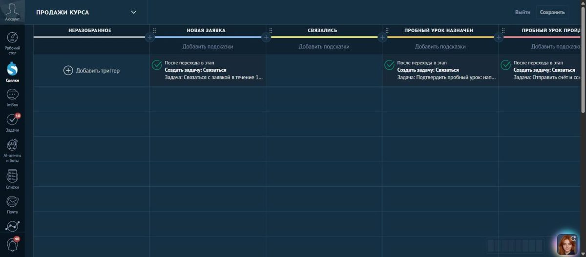

# Заявки с сайта в amoCRM через n8n + ИИ-оценка лида

Внедрение amoCRM для онлайн-школы иллюстрации «Чёрный кот» (собственный проект): воронки продаж, роботы и автоматическая обработка заявок с сайта.


## Как работает

```
Форма на сайте → n8n (вебхук)
  1. Нормализация: телефон → +7XXXXXXXXXX, тариф и уровень → значения списков amoCRM, без телефона — ошибка
  2. ИИ-оценка: локальная модель (Ollama, qwen2.5) ставит 0–100 и пишет сводку для менеджера
  3. Поиск контакта по телефону: если клиент уже был — привязываем к нему, тег «повторная заявка»
  4. Сделка в amoCRM (API v4, /leads/complex): тариф, бюджет, уровень, цель, источник, ИИ-оценка и сводка
  5. Сообщение менеджеру в Telegram: «🔥 Горячая заявка» при оценке от 70, ссылка на сделку
  Каждый запрос к amoCRM и Telegram — до 3 повторов при сбое
```

## Настройка amoCRM

- Воронка «Продажи курса»: Новая заявка → Связались → Пробный урок назначен → Пробный урок пройден → Счёт отправлен → Оплачено / Отказ.
- Воронка «Ученики»: Учится → Середина курса → Курс завершён → Предложено продление.
- Поля: тариф, источник, уровень, цель, дата пробного урока, дата оплаты, ИИ-оценка, ИИ-сводка; у контакта Telegram и город.
- Причины отказа и роботы на этапах: задача «связаться за 15 минут», «подтвердить пробный урок», «отправить счёт», «проверить оплату через день».
- Поля, воронки и демо-данные (60 заявок) созданы через API amoCRM.

| Воронка | Карточка сделки | Роботы |
|---|---|---|
|  |  |  |

## Что пришлось решить при отладке

| Проблема | Причина | Решение |
|---|---|---|
| ИИ не отвечал | Node 22 на Windows ходит на `localhost` по IPv6, Ollama слушает IPv4 | адрес `127.0.0.1` |
| Пустой запрос к ИИ и пустое сообщение в Telegram | выражения `$('Блок').item` теряли связь элементов после HTTP-запроса | логика перенесена в блоки Code, в остальных только `$json` |
| Дубли контактов | amoCRM отвечает `application/hal+json`, n8n отдавал ответ строкой | разбор ответа в блоке «Сборка сделки», поиск по 10 последним цифрам телефона |
| Telegram «can't parse entities» | Markdown ломался на нике с подчёркиванием | HTML-режим с экранированием |

## Файлы

- `kurs_lead.json` — сценарий для импорта в n8n (без ключей: ключ amoCRM и токен бота подключаются в n8n).
- `make_workflow.py` — генератор сценария: `python make_workflow.py <telegram chat id>`.
